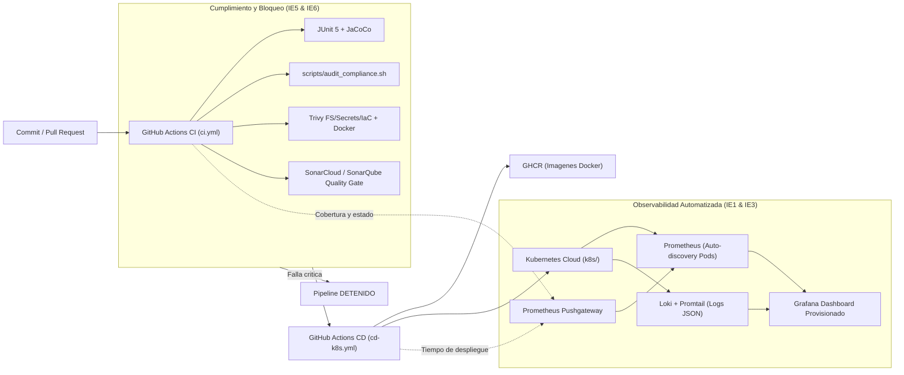

# Observabilidad, Kubernetes Cloud y Cumplimiento Automatizado (EP3)

> **Asignatura:** Ingeniería DevOps (DOY0101) — Duoc UC  
> **Evaluación:** Evaluación Parcial N°3: "Observabilidad y entornos reales en DevOps"  
> **Repositorio:** `https://github.com/Nicolasmaker/sistema_incidencias-`

---

## 1. Arquitectura de Observabilidad y CI/CD (IE1, IE2, IE3, IE4)

La arquitectura extiende el pipeline de EP1 y EP2 incorporando trazabilidad de extremo a extremo desde el commit hasta la operación en un clúster **Kubernetes en la nube**:



---

## 2. Integración de Herramientas en el Pipeline CI/CD (IE4)

| Capa | Herramienta | Archivo / Configuración | Propósito en el Pipeline |
| :--- | :--- | :--- | :--- |
| **Métricas de Aplicación** | Spring Boot Actuator + Micrometer Prometheus | `backend/pom.xml`, `application.properties` | Expone `/actuator/prometheus`, `/actuator/health/liveness` y `/actuator/health/readiness` con métricas JVM, CPU, memoria y códigos HTTP. |
| **Métricas de Infraestructura** | `nginx-prometheus-exporter` y `mysqld-exporter` | `frontend/nginx.conf`, `k8s/03-mysql.yaml`, `k8s/05-frontend.yaml` | Recolecta métricas de disponibilidad, conexiones y rendimiento del frontend y la base de datos. |
| **Logging Estructurado** | Spring Boot ECS JSON + Nginx JSON + Loki/Promtail | `observability/loki/`, `observability/promtail/` | Centraliza logs estructurados de todos los microservicios para búsqueda y correlación de errores. |
| **Dashboards y Métricas CI/CD** | Grafana + Prometheus Pushgateway | `observability/grafana/dashboards/incidencias-devops.json`, `.github/workflows/ci.yml` | Visualiza en un solo panel: disponibilidad, CPU/RAM, errores HTTP, logs, **tiempo de despliegue**, **cobertura JaCoCo** y estado del Quality Gate. |
| **Orquestación Cloud** | Kubernetes + Kustomize + HPA | `k8s/*.yaml`, `.github/workflows/cd-k8s.yml` | Despliega automáticamente los microservicios y el stack de observabilidad con auto-discovery por anotaciones `prometheus.io/*`. |
| **Calidad y Cumplimiento** | SonarCloud/SonarQube + `audit_compliance.sh` + Branch Protection | `sonar-project.properties`, `scripts/audit_compliance.sh` | Evalúa deuda técnica, bugs, cobertura mínima, ausencia de secretos y endurecimiento de Docker/K8s. |
| **Seguridad Bloqueante** | Trivy (FS, Secretos, IaC, Imagen) + Snyk | `.github/workflows/ci.yml` | Interrumpe el pipeline (`exit-code: 1`) si detecta vulnerabilidades `CRITICAL`/`HIGH` o secretos expuestos. |

---

## 3. Cómo las Métricas Apoyan la Toma de Decisiones Técnicas (IE4)

| Métrica Observada | Señal / Umbral de Alerta | Decisión Técnica Informada | Impacto en Mejora Continua |
| :--- | :--- | :--- | :--- |
| **Disponibilidad (`up == 0`)** | Microservicio caído > 1 min | Revisar eventos del Pod (`kubectl describe pod`) y logs en Loki; activar rollback automático si coincide con un despliegue reciente. | Reduce el MTTR (Mean Time to Recovery) y protege el SLA. |
| **Tasa de errores HTTP `5xx`** | > 5% durante 2 min | Correlacionar stack traces en Grafana/Loki, revertir la última imagen desplegada (`kubectl rollout undo`) y crear un `hotfix/*` con prueba de regresión. | Evita que fallas funcionales degraden la experiencia en producción. |
| **Uso de CPU y Memoria JVM Heap** | CPU > 80% o Heap > 85% | Validar activación del **HPA** (`incidencias-backend-hpa`), ajustar `requests`/`limits` en `k8s/04-backend.yaml` o perfilar consultas JPA lentas. | Optimiza costos en la nube y previene reinicios por `OOMKilled`. |
| **Cobertura de Pruebas (JaCoCo)** | < 50% (umbral mínimo) | El Quality Gate bloquea el PR; el equipo agrega pruebas unitarias JUnit 5/Mockito antes de integrar a `develop`/`main`. | Mantiene la confiabilidad de la base de código frente a refactorizaciones. |
| **Tiempo de Despliegue CI/CD** | > 300 segundos | Optimizar caché de capas Docker y Maven en GitHub Actions para reducir tiempos de feedback. | Acelera el *Lead Time for Changes* (métrica DORA). |
| **Vulnerabilidades / Secretos** | ≥ 1 `CRITICAL`/`HIGH` o secreto | El pipeline se detiene (`IE6`); se actualiza la dependencia vulnerable o se rota la credencial antes de continuar. | Garantiza cumplimiento normativo y principio *Shift-Left Security*. |

---

## 4. Guía de Ejecución y Despliegue (Local y Kubernetes Cloud)

### 4.1. Ejecución Local con Observabilidad Completa
```bash
cp .env.example .env
# Editar .env definiendo contraseñas locales
docker compose --profile observability up -d --build
```
Accesos locales:
- **Backend API / Métricas:** `http://localhost:8080/actuator/prometheus`
- **Frontend:** `http://localhost:8081`
- **Prometheus:** `http://localhost:9090`
- **Grafana (Dashboard EP3 pre-cargado):** `http://localhost:3000`
- **Pushgateway:** `http://localhost:9091`

### 4.2. Configuración de Secretos en GitHub para Despliegue Cloud (IE2 / IE5)
En **Settings → Secrets and variables → Actions** del repositorio:
- `KUBECONFIG_B64`: Archivo `~/.kube/config` del clúster en la nube (EKS, k3s en EC2, AKS o GKE) codificado en Base64.
- `MYSQL_USER`, `MYSQL_PASSWORD`, `MYSQL_ROOT_PASSWORD`: Credenciales inyectadas en el Secret de Kubernetes.
- `SONAR_TOKEN`: Token de SonarCloud o SonarQube para el Quality Gate bloqueante.
- `SNYK_TOKEN` *(opcional)*: Token de Snyk CLI.
- `PUSHGATEWAY_URL` *(opcional)*: URL pública/interna del Pushgateway para registrar métricas desde GitHub Actions.

### 4.3. Configuración de Branch Protection Rules en GitHub (IE5)
En **Settings → Branches → Add branch protection rule** para `main` y `develop`:
1. Activar **Require a pull request before merging** (mínimo 1 aprobación).
2. Activar **Require status checks to pass before merging** seleccionando:
   - `Build, JUnit 5 & Cobertura JaCoCo`
   - `Quality Gates de Seguridad, Auditoria & Contenedores`
   - `SonarQube / SonarCloud Quality Gate`
3. Activar **Do not allow bypassing the above settings**.

---

## 5. Procedimiento de Demostración de Detención del Pipeline (IE6)

Para evidenciar ante el docente que el pipeline se detiene automáticamente ante una falla crítica:

1. Crear una rama de prueba:
   ```bash
   git checkout -b test/demo-bloqueo-ie6
   ```
2. Introducir una falla crítica controlada (por ejemplo, una credencial simulada `SPRING_DATASOURCE_PASSWORD=clave_expuesta` en `backend/src/main/resources/application.properties` o eliminar una prueba para bajar la cobertura).
3. Hacer commit y push a GitHub y abrir un Pull Request hacia `develop`:
   ```bash
   git add .
   git commit -m "test: simula falla critica de seguridad para demostrar bloqueo IE6"
   git push -u origin test/demo-bloqueo-ie6
   ```
4. Verificar en la pestaña **Actions** que:
   - El job **Quality Gates de Seguridad, Auditoria & Contenedores** falla con código de salida `1` (`ERROR CRITICO [SEC-01]`).
   - El Pull Request muestra el check rojo y **bloquea el merge**, impidiendo que el cambio llegue a `main` o se despliegue a Kubernetes.
5. Capturar evidencia del log fallido y luego cerrar/eliminar la rama de prueba.

---

## 6. Declaración de Uso de Inteligencia Artificial (Normativa Duoc UC)

> *Referencia normativa: [Guía de citación y uso ético de IA - Bibliotecas Duoc UC](https://bibliotecas.duoc.cl/ia).*

- **Herramienta utilizada:** *[Completar por el equipo: nombre de la herramienta de IA y versión]*
- **Uso aplicado:** Apoyo en la estructuración técnica de manifiestos Kubernetes, configuración inicial de observabilidad (Prometheus/Loki/Grafana), automatización de scripts de auditoría y revisión de redacción/diagramas. Todo el contenido fue revisado, probado y validado por el equipo.
- **Restricción cumplida:** Las conclusiones, justificaciones técnicas propias y reflexiones individuales que siguen a continuación fueron redactadas íntegramente por los estudiantes sin apoyo de IA.

---

## 7. Conclusiones y Reflexiones Individuales *(Completar manualmente por el equipo sin IA)*

### Conclusiones del Equipo
> *[Espacio reservado para que el equipo redacte sus conclusiones técnicas propias sin uso de IA.]*

### Reflexión Individual — Integrante 1 (Francisca López)
> *[Espacio reservado para la reflexión personal redactada sin IA: aprendizaje obtenido y contribución específica al proyecto.]*

### Reflexión Individual — Integrante 2 (Nicolás)
> *[Espacio reservado para la reflexión personal redactada sin IA: aprendizaje obtenido y contribución específica al proyecto.]*
