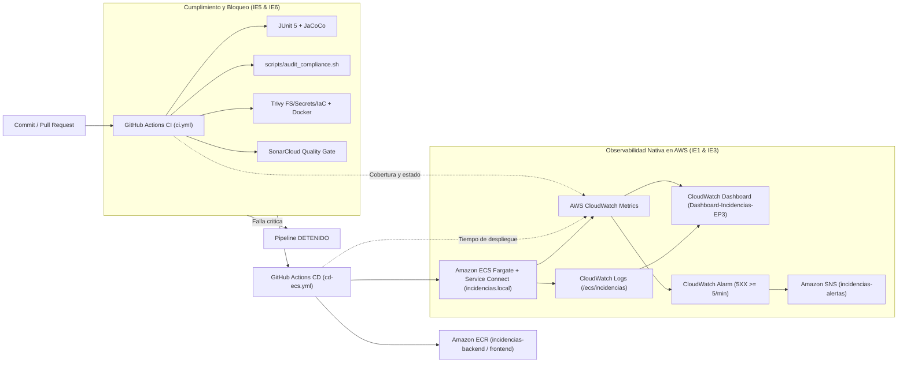

# Observabilidad en AWS CloudWatch, Amazon ECS Fargate y Cumplimiento Automatizado (EP3)

> **Asignatura:** Ingeniería DevOps (DOY0101) — Duoc UC  
> **Evaluación:** Evaluación Parcial N°3: "Observabilidad y entornos reales en DevOps"  
> **Repositorio:** `https://github.com/Nicolasmaker/sistema_incidencias-`

---

## 1. Arquitectura en AWS: Amazon ECS Fargate + Service Connect + Amazon ECR + CloudWatch (IE1, IE2, IE3, IE4)

La arquitectura extiende el pipeline de EP1 y EP2 incorporando trazabilidad de extremo a extremo desde el commit hasta la operación en **Amazon ECS Fargate** con **Service Connect (Envoy)**, registro de imágenes en **Amazon ECR** y observabilidad nativa en **AWS CloudWatch + SNS**:

---

## 2. Integración de Herramientas en el Pipeline CI/CD (IE4)

| Capa | Herramienta | Archivo / Configuración | Propósito en el Pipeline |
| :--- | :--- | :--- | :--- |
| **Salud y Logs de Aplicación** | Spring Boot Actuator + Logs JSON ECS + Nginx `/healthz` | `backend/pom.xml`, `application.properties`, `frontend/nginx.conf` | Expone `/actuator/health/liveness`, `/actuator/health/readiness` y logs JSON enviados automáticamente a `/ecs/incidencias` mediante el driver `awslogs`. |
| **Registro de Contenedores** | **Amazon ECR** (`scanOnPush=true`) | `.github/workflows/cd-ecs.yml` | Almacena las imágenes Docker versionadas de `incidencias-backend` e `incidencias-frontend` dentro de AWS. |
| **Orquestación Cloud (`IE2`)** | **Amazon ECS Fargate + Service Connect** | `ecs/taskdef-*.json`, `scripts/deploy_ecs_aws.sh` | Despliega automáticamente los microservicios (`mysql`, `incidencias-backend` con 2 réplicas e `incidencias-frontend`) con proxy Envoy administrado, descubrimiento DNS (`mysql:3306`) y **Container Insights**. |
| **Monitoreo, Dashboards y Alertas (`IE1` / `IE3`)** | **AWS CloudWatch** (Metrics, Logs, Dashboard, Alarms) + **Amazon SNS** | `ecs/cloudwatch-dashboard.json`, `.github/workflows/ci.yml`, `.github/workflows/cd-ecs.yml` | Visualiza CPU/Memoria (Container Insights), tráfico/latencia/errores 4XX-5XX (Service Connect), logs (`/ecs/incidencias`), **tiempo de despliegue** y **cobertura JaCoCo** (`Incidencias/CICD`), con alarma `Incidencias-5XX-Alarm` conectada a SNS. |
| **Calidad y Cumplimiento (`IE5`)** | **SonarCloud** + `audit_compliance.sh` + **Branch Protection** | `sonar-project.properties`, `scripts/audit_compliance.sh` | Evalúa deuda técnica, seguridad, cobertura mínima JaCoCo, ausencia de secretos y políticas de Docker/ECS. |
| **Seguridad Bloqueante (`IE6`)** | **Trivy** (FS, Secretos, IaC, Imagen) + **Snyk** | `.github/workflows/ci.yml` | Interrumpe automáticamente el pipeline (`exit-code: 1`) ante vulnerabilidades `CRITICAL` o hallazgos críticos de seguridad. |

---

## 3. Cómo las Métricas Apoyan la Toma de Decisiones Técnicas (IE4)

| Métrica Observada | Señal / Umbral de Alerta | Decisión Técnica Informada | Impacto en Mejora Continua |
| :--- | :--- | :--- | :--- |
| **Errores HTTP `5XX` (`HTTPCode_Target_5XX_Count`)** | `>= 5` en 1 min (`Incidencias-5XX-Alarm`) | Dispara alerta vía **Amazon SNS**; el equipo inspecciona `/ecs/incidencias` en CloudWatch Logs y revierte a la revisión anterior de la Task Definition en ECS. | Reduce el MTTR y evita degradación prolongada en producción. |
| **Latencia (`TargetResponseTime`)** | Incremento sostenido | Analizar consultas JPA en los logs JSON y evaluar escalado de tareas (`desiredCount`) en `incidencias-backend`. | Mantiene tiempos de respuesta estables bajo carga. |
| **CPU y Memoria (`Container Insights`)** | > 80% sostenido | Ajustar `cpu`/`memory` en `ecs/taskdef-backend.json` o incrementar réplicas del servicio Fargate. | Optimiza costos y estabilidad de contenedores. |
| **Cobertura de Pruebas (`TestCoveragePercent`)** | < 50% (umbral mínimo) | El Quality Gate bloquea el PR; se agregan pruebas unitarias JUnit 5/Mockito antes de integrar. | Previene regresiones en la lógica de negocio. |
| **Tiempo de Despliegue (`DeployDurationSeconds`)** | > 300 segundos | Optimizar capas Docker y caché Maven en GitHub Actions. | Mejora el *Lead Time for Changes* (DORA). |
| **Vulnerabilidades / Secretos (`SecurityVulnerabilities`)** | `>= 1` hallazgo crítico | El pipeline se detiene (`IE6`); se parchea la dependencia en `pom.xml` o se rota el secreto antes de desplegar a ECR/ECS. | Garantiza cumplimiento normativo (*Shift-Left Security*). |

---

## 4. Configuración de Secretos en GitHub para AWS Academy (`IE2`, `IE3`, `IE5`)

En **Settings → Secrets and variables → Actions** del repositorio:
- `AWS_ACCESS_KEY_ID`, `AWS_SECRET_ACCESS_KEY`, `AWS_SESSION_TOKEN`: Credenciales activas de AWS Academy Learner Lab (`us-east-1`).
- `MYSQL_USER`, `MYSQL_PASSWORD`, `MYSQL_ROOT_PASSWORD`: Credenciales inyectadas en las Task Definitions de ECS en tiempo de despliegue.
- `SONAR_TOKEN`: Token de SonarCloud para el Quality Gate bloqueante.
- `SNYK_TOKEN` *(opcional)*: Token de Snyk CLI.

### Dónde verificar todo en la consola de AWS (`us-east-1`)
- **Repositorios de imágenes:** `ECR → Repositories` (`incidencias-backend`, `incidencias-frontend`)
- **Clúster y Service Connect:** `ECS → Clusters → incidencias-ecs → Services`
- **Dashboard integral:** `CloudWatch → Dashboards → Dashboard-Incidencias-EP3`
- **Métricas personalizadas CI/CD:** `CloudWatch → Metrics → Incidencias/CICD`
- **Logs centralizados:** `CloudWatch → Log groups → /ecs/incidencias`
- **Alarma y notificaciones:** `CloudWatch → Alarms → Incidencias-5XX-Alarm` y `SNS → Topics → incidencias-alertas`

---

## 5. Declaración de Uso de Inteligencia Artificial (Normativa Duoc UC)

> *Referencia normativa: [Guía de citación y uso ético de IA - Bibliotecas Duoc UC](https://bibliotecas.duoc.cl/ia).*

- **Herramienta utilizada:** *[Completar por el equipo: nombre de la herramienta de IA y versión]*
- **Uso aplicado:** Apoyo en la estructuración técnica de las Task Definitions de Amazon ECS Fargate, configuración de Amazon ECR, dashboards/alarmas de AWS CloudWatch, scripts de auditoría y revisión de redacción/diagramas. Todo el contenido fue revisado, probado y validado por el equipo.
- **Restricción cumplida:** Las conclusiones, justificaciones técnicas propias y reflexiones individuales que siguen a continuación fueron redactadas íntegramente por los estudiantes sin apoyo de IA.

---

## 6. Conclusiones y Reflexiones Individuales *(Completar manualmente por el equipo sin IA)*

### Conclusiones del Equipo
> *[Espacio reservado para que el equipo redacte sus conclusiones técnicas propias sin uso de IA.]*

### Reflexión Individual — Integrante 1 (Francisca López)
> *[Espacio reservado para la reflexión personal redactada sin IA: aprendizaje obtenido y contribución específica al proyecto.]*

### Reflexión Individual — Integrante 2 (Nicolás)
> *[Espacio reservado para la reflexión personal redactada sin IA: aprendizaje obtenido y contribución específica al proyecto.]*
